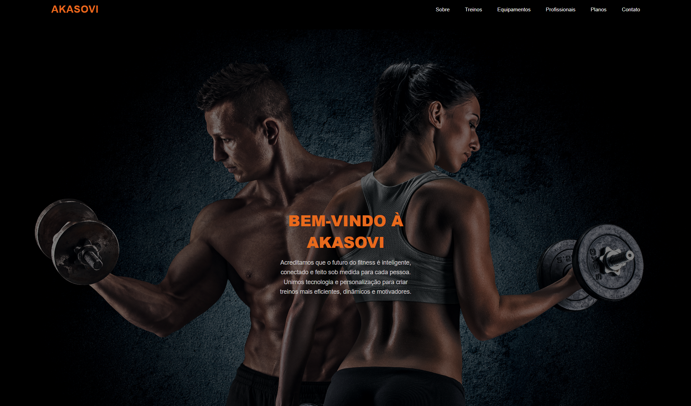

<div align="center">

# AKASOVI

**Site institucional de um centro de treinamento de alta performance**

Uma marca fictícia criada do zero, da identidade visual à presença digital completa, com uma abertura animada e seis páginas sobre a experiência AKASOVI.

[](https://akasovi.vercel.app/)


<sub>SENAC · Ensino Médio Técnico em Informática</sub>



</div>

---

## Sobre o projeto

O AKASOVI nasceu de um desafio de criação total: inventar uma marca e construir toda a sua presença na web. O resultado é um centro de treinamento fictício de **10.000 m²**, apresentado como o maior da América Latina, que une tecnologia, performance e bem-estar.

Além do código, o projeto definiu o conceito completo da marca:

- **Posicionamento:** uma academia inteligente e conectada, com equipamentos que ajustam a carga sozinhos e acompanham a evolução de cada aluno.
- **Metodologia:** três programas de treino (Hipertrofia, Emagrecimento e AKASOVI Master, para pessoas com mais de 60 anos).
- **Equipe:** perfis de personal trainers, nutricionista e instrutora.
- **Modelo de negócio:** três planos de assinatura, com benefícios crescentes.

---

## Destaques

- **Abertura animada com GSAP:** uma linha do tempo de animação revela a marca com efeito de máscara e desfoque e leva o visitante direto para o site.
- **Seis páginas independentes,** com navegação e rodapé consistentes em todas elas.
- **Layout responsivo,** que se adapta do celular ao computador.
- **CSS organizado por seção** (navegação, cada página, rodapé e responsividade), o que facilita a manutenção.
- **Identidade visual própria:** logo, paleta, tipografia e imagens pensadas para a marca.

---

## Páginas

| Página | Conteúdo |
|---|---|
| **Intro** | Abertura animada que apresenta a marca e redireciona para o site |
| **Sobre** | Apresentação da AKASOVI, do espaço e da proposta |
| **Treinos** | Os três programas, como funciona o acompanhamento e os benefícios |
| **Equipamentos** | A tecnologia dos aparelhos inteligentes e uma galeria do espaço |
| **Profissionais** | A equipe, com a função e a especialidade de cada pessoa |
| **Planos** | Essencial, Performance e Premium Future, com preços e benefícios |
| **Contato** | Endereço, telefone e formulário de inscrição |

---

## Como executar

O site é estático: não precisa de instalação nem de build.

```bash
git clone https://github.com/SofiaHagio/AKASOVI.git
cd AKASOVI
```

Depois, abra o projeto com a extensão **Live Server** do VS Code (botão direito no `index.html` → **Open with Live Server**). Assim, a abertura animada e todos os caminhos de arquivo funcionam como no site publicado.

> Para pular a abertura e ir direto ao conteúdo, abra `pages/sobre.html`.

---

## Estrutura

```
AKASOVI/
├── index.html              # Abertura animada
├── pages/                  # Sobre, Treinos, Equipamentos, Profissionais, Planos e Contato
├── assets/
│   ├── css/
│   │   ├── intro.css       # Estilos da abertura
│   │   └── style.css       # Estilos do site, organizados por seção
│   ├── js/
│   │   └── script.js       # Animação da abertura com GSAP
│   └── images/             # Imagens de cada página e preview do projeto
└── README.md
```

---

## Equipe

| Nome |
|---|
| Ana Clara Tamborini Bossolan |
| Kadu Nunes Zambon Minardi Azevedo |
| Sofia Satomi Hagio |
| Victoria Haruka Ishi |
